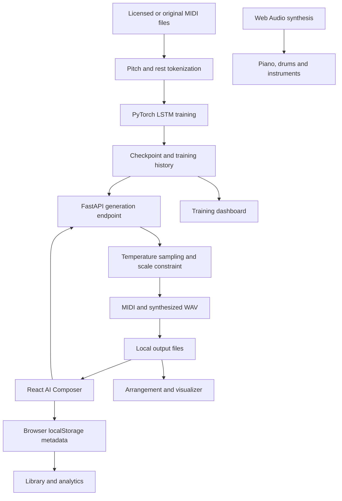

<div align="center">

# 🎵 SonataAI

### Make sound. Make it yours.

**AI-powered melody generation & interactive music production studio**


**CodeAlpha Artificial Intelligence Internship · Task 3 — Music Generation with AI**

[Features](#studio-workspaces) · [Architecture](#system-architecture) · [Setup](#quick-start) · [Model results](#training-results) · [API](#api-reference) · [Testing](#testing)

</div>

## Overview

SonataAI combines a CPU-friendly stacked LSTM melody generator with a React music workstation. It learns next-note patterns from MIDI sequences and generates new monophonic melodies with controllable tempo, temperature, seed, key and scale. It also provides browser-based instruments, rhythm sequencing, audio visualization and clip arrangement. The original Streamlit prototype remains available alongside the new studio.

## Studio workspaces

| Workspace | Implemented capabilities |
| --- | --- |
| 🏠 Studio | Animated vinyl artwork, illustrated navigation cards, saved-track statistics, session BPM, recent compositions |
| ✨ AI Composer | Tempo and creativity, four mood parameter presets, MIDI instrument selection, sequence length, key, scale, random seed, optional trained genre conditioning, playback, live spectrum, WAV/MIDI downloads, recent generations |
| 🎛 Arrangement | Four audio lanes, library clip selection, drag-and-drop, moving playhead, timeline span, start/duration editing, duplication, deletion, simultaneous clip playback, local session save/open |
| 🎹 Piano Studio | 36-key polyphonic synthesized keyboard, pointer/computer-key input, octave and velocity controls, four oscillator waveforms, live waveform, recording timer, piano roll, note editing and MIDI export |
| 🥁 Beat Maker | Eight synthesized drum sounds, 16-step sequencer, Classic/House/Hip hop/Breakbeat presets, randomize, clear, animated pads, real output waveform, gain and mute |
| 🎚 Mixer | Eight drum channels, audition, stereo pan, gain faders, mute/solo, peak dBFS meters, master gain, echo and reset |
| 🎼 Instruments | Velvet Keys, Glass Bell, Retro Lead, Pulse Synth, 12-key keyboard, octave, volume, low-pass filter, note glow and live oscilloscope |
| 💿 Music Library | Automatic metadata saving, search, sort, favorites, rename, grid/list views, playback, seek, repeat, volume, WAV/MIDI downloads, remove metadata |
| 🌈 Visualizer | Frequency spectrum, orbit, particles, true time-domain waveform, fullscreen, four palettes, library player and collapsible EQ/compressor/delay/reverb rack |
| 🧠 Training | Checkpoint availability, recorded loss curves, validation accuracy, epoch table, architecture illustration, offline training command |
| 📊 Analytics | Composition metrics, pitch-class token counts, genre distribution, tempo bands, model loss history, date filter and refresh |

### UI and interaction

- Dark music-inspired interface with purple, cyan, pink, amber and blue accents.
- Six shell theme presets: Aurora, Gold, Cyber, Ocean, Crimson and Arctic.
- Collapsible navigation, independent workspace scrolling and Command/Ctrl + K navigation.
- Motion toggle, animated artwork, audio-reactive canvases and responsive layouts.
- No repeated full production panels on the Studio landing page or persistent floating player.

Decorative animation is distinct from measured audio signals. The visualizer and oscilloscope use Web Audio analyser data; training charts use recorded epoch history.

## System architecture



### Technology stack

| Layer | Technology |
| --- | --- |
| Frontend | React 19, TypeScript 5.7, Vite 6, CSS, SVG, Canvas |
| Backend | Python, FastAPI, Pydantic, Uvicorn |
| Machine learning | PyTorch, stacked LSTM, categorical sampling |
| Music processing | pretty_midi, NumPy, Python wave |
| Browser audio | Web Audio API, oscillators, filters, analysers, stereo panning |
| Storage | Local filesystem for outputs; browser localStorage for metadata and arrangement sessions |
| Original interface | Streamlit |
| Testing | pytest, FastAPI TestClient, TypeScript build, GitHub Actions |

## Machine learning pipeline

1. Read non-drum notes from MIDI files.
2. Sample at 8 Hz, retaining the highest active pitch or rest.
3. Encode MIDI pitches 0–127 and rest token 128.
4. Create 33-token windows at stride 4 and predict the next token from 32 preceding tokens.
5. Train using cross-entropy and Adam (learning rate 0.003, batch size 64), with file-level validation separation.
6. Sample autoregressively from temperature-scaled logits using a seeded random generator.
7. Snap notes to the chosen musical scale, then export MIDI and 22,050 Hz mono PCM WAV.

| Model parameter | Original LSTM | Optional genre LSTM |
| --- | --- | --- |
| Vocabulary | 129 | 129 |
| Note embedding | 32 | 32 |
| Genre embedding | — | 16 |
| Recurrent layers | 2 | 2 |
| Hidden size | 64 | 64 |
| Output logits | 129 | 129 |

## Training results

The baseline checkpoint was documented as trained for eight epochs using 12 original procedurally generated MIDI melodies (11 training and 1 validation). The following values are recorded in [history.json](history.json).

| Epoch | Training loss | Validation loss | Validation token accuracy |
| ---: | ---: | ---: | ---: |
| 1 | 4.653 | 4.118 | 13.69% |
| 2 | 3.330 | 2.957 | 9.38% |
| 3 | 2.566 | 2.643 | 9.47% |
| 4 | 2.415 | 2.536 | 25.64% |
| 5 | 2.307 | 2.398 | 11.95% |
| 6 | 2.222 | 2.303 | 13.33% |
| 7 | 2.137 | 2.242 | 21.23% |
| 8 | 2.049 | 2.158 | 29.78% |

Training loss decreased by approximately 56.0%. Token accuracy is not a measure of musical quality. The small procedural dataset and single validation piece do not establish generalization to diverse musical genres.

## Quick start

Recommended: Python 3.11 or 3.12, Node.js 22, npm and Git. No Docker required.

```bash
git clone https://github.com/yasmeenmh90-beep/CodeAlpha_MusicGenerationWithAI.git
cd CodeAlpha_MusicGenerationWithAI
python3 -m venv .venv
source .venv/bin/activate
python -m pip install -r requirements-api.txt
python -m uvicorn api:app --port 8000
```

In a second terminal, from the repository root:

```bash
cd studio
npm install
npm run dev -- --port 5173
```

Open **http://localhost:5173**. The API is at http://localhost:8000 and interactive API documentation at http://localhost:8000/docs. Keep both processes running.

For a custom API origin, set VITE_API_URL in the frontend environment before launching or building. Update API CORS origins when necessary. Default allowed origins are localhost and 127.0.0.1 on port 5173.

### Original Streamlit interface

```bash
source .venv/bin/activate
python -m streamlit run app.py
```

### Generate or train from the command line

```bash
python music.py generate
python music.py train --data /path/to/licensed-midi --epochs 30
```

The generation command writes composition.mid and composition.wav. Training replaces model.pt and history.json; back up the existing files first. Supply MIDI pieces longer than four seconds, preferably enough distinct pieces for a meaningful validation split.

### Optional genre-conditioned model

Arrange appropriately licensed MIDI files in genre_data/ambient, classical, electronic, jazz, cinematic and lofi subdirectories. Each genre requires at least two distinct pieces longer than four seconds.

```bash
python conditioning.py --data genre_data --epochs 15
```

This writes conditioned.pt and conditioned_history.json separately from the baseline. Refresh Training after completion. The Composer enables learned genre selection when the checkpoint exists. Genre training is supported in code; a trained genre checkpoint and its quality are not established by this review.

## API reference

| Method | Endpoint | Purpose |
| --- | --- | --- |
| GET | /health | Baseline and conditioned checkpoint availability |
| POST | /generate | Generate a composition and export files |
| GET | /tracks/{key}/wav | Retrieve generated WAV |
| GET | /tracks/{key}/mid | Retrieve generated MIDI |
| GET | /training/history | Baseline and conditioned epoch records |

Example:

```bash
curl -X POST http://localhost:8000/generate \
  -H 'Content-Type: application/json' \
  -d '{"bpm":128,"temperature":0.9,"length":128,"program":0,"seed":42,"root":0,"scale":"major","genre":null}'
```

The response includes id, wav, midi, duration and tokens. The returned file URLs are relative to the API origin.

| Parameter | Accepted values |
| --- | --- |
| bpm | 30–240 |
| temperature | Greater than 0, up to 3 (studio slider 0.1–2) |
| length | 16–512 tokens |
| program | 0–127 (studio offers four presets) |
| seed | 0–2147483647 |
| root | 0–11 |
| scale | chromatic, major, minor, pentatonic |
| genre | null or one of six supported genres |

Invalid settings return 422; a missing conditioned checkpoint returns 409; missing or unsupported track files return 404.

## Repository structure

```text
CodeAlpha_MusicGenerationWithAI/
├── app.py                     # Original Streamlit interface
├── music.py                   # Baseline LSTM and audio export
├── conditioning.py            # Optional genre model and scale constraints
├── api.py                     # FastAPI service
├── model.pt                   # Baseline checkpoint
├── history.json               # Recorded training metrics
├── requirements.txt
├── requirements-api.txt
├── studio/
│   ├── package.json
│   ├── README.md
│   └── src/
│       ├── main.tsx           # Application shell
│       ├── StudioHome.tsx
│       ├── Player.tsx         # AI Composer
│       ├── Arrangement.tsx
│       ├── Piano.tsx
│       ├── Beat.tsx           # Beat Maker and drum mixer
│       ├── Instruments.tsx
│       ├── Library.tsx
│       ├── GlobalDeck.tsx     # Visualizer and player FX
│       ├── Training.tsx
│       ├── Analytics.tsx
│       └── *.css
├── tests/test_studio_api.py
└── .github/workflows/studio-ci.yml
```

Generated studio_outputs/ files reside on the backend filesystem. Arrangement sessions store references rather than embedding the audio files.

## Testing

```bash
source .venv/bin/activate
python -m pip install pytest httpx
python -m pytest tests/test_studio_api.py -v
cd studio
npm install
npm run build
```

Six backend test functions cover health, invalid settings, missing tracks, scale constraints, generation with WAV/MIDI signatures and training history. CI defines frontend type checking/build and backend test jobs on pushes and pull requests. See [GitHub Actions](https://github.com/yasmeenmh90-beep/CodeAlpha_MusicGenerationWithAI/actions).

**Verification status:** source-level review completed for principal application modules; latest build, test execution and browser behavior have not been independently verified. The CI badge reflects GitHub's reported workflow state, not a claimed successful local run.

Manual smoke checks: generate and download a composition; play it from the library; arrange and save clips; record and export piano notes; audition drums and change channel gains; switch visualizer modes and palettes; refresh training and analytics; check small-screen layout.

## Deployment and security

Build with npm run build from studio/ (output studio/dist). Set VITE_API_URL before building and configure CORS, HTTPS and persistent writable output storage. This is a trusted local educational application, not a hardened multiuser service. Public deployment would require authentication, quotas, output retention/cleanup, resource limits and operational monitoring. No public deployment is asserted.

## Known limitations and roadmap

- Baseline generation is monophonic; no learned chords, lyrics or natural-language text-to-music.
- Mood buttons configure parameters; they are not learned mood conditioning.
- MIDI program selection affects MIDI metadata, not the harmonic WAV renderer. Browser instruments and drums use synthesis, not acoustic sample libraries.
- Mixer processes drums only; the visualizer FX process its own library playback. No unified cross-workspace audio routing or persistent global transport.
- Arrangement supports clip references and duration trimming, not full multitrack rendering/export or complete project-state persistence.
- Training is offline; UI displays recorded history, not live training progress.
- Browser-local storage is not cloud synchronization; removing metadata does not delete backend output files.
- The piano octave-7 setting can produce pitches beyond MIDI 127 on the 36-key range; constrain the range before relying on high-octave MIDI export.
- Frontend/browser regression testing, larger licensed datasets, polyphonic modeling, sampled instruments and integrated production routing remain future work.

## Credits

Developed as part of the CodeAlpha Artificial Intelligence internship, Task 3. Built with PyTorch, pretty_midi, React, FastAPI and Web Audio API. Use only MIDI material for which you have appropriate rights.

<div align="center">

**SonataAI — Make sound. Make it yours.**

</div>
